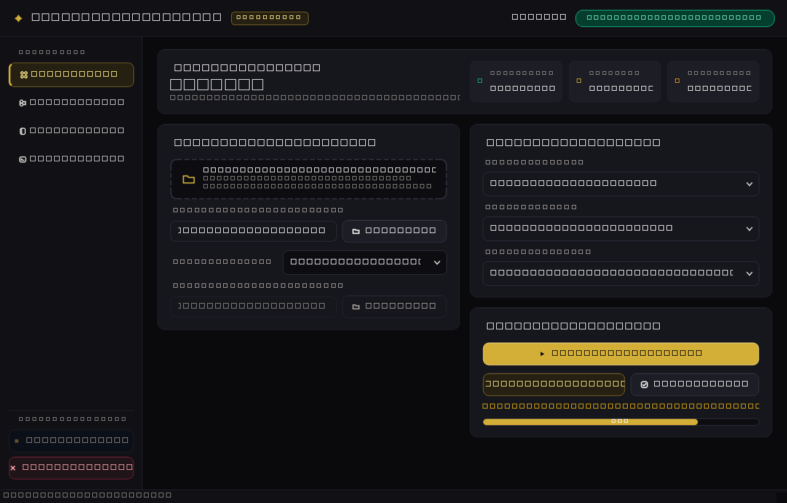
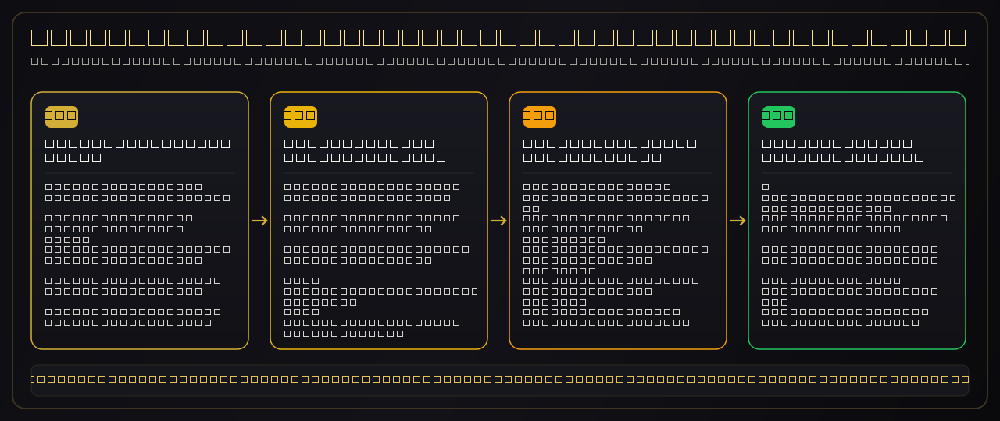
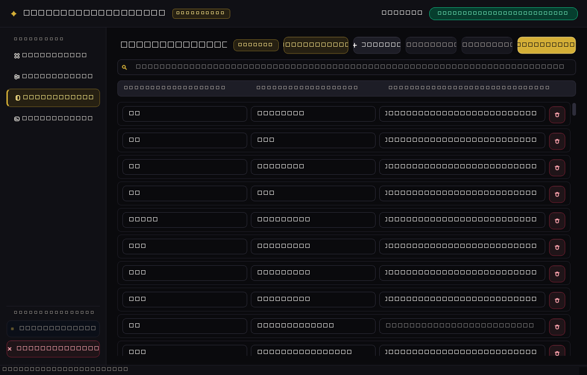
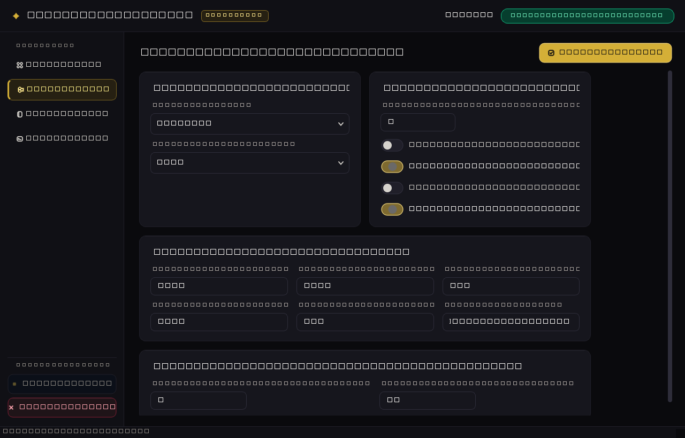
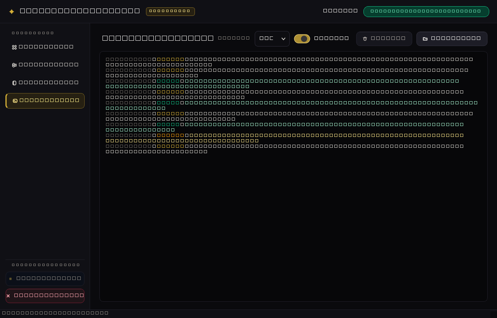
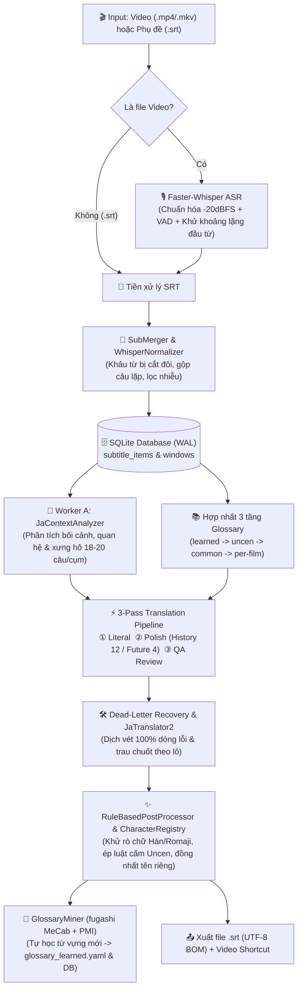

# 🎬 Subtitle Translator — Studio Pro Edition (v2.0)

<p align="center">
  
</p>

> **Công cụ nhận diện giọng nói (Faster-Whisper) & dịch phụ đề video tự động bằng AI nội bộ (Ollama LLM)** với cơ chế **Dịch 3 vòng ngữ cảnh (3-Pass Context Engine)**, **Hậu kiểm Luật thông minh (Rule-Based Post-Processor)** và **Tự học từ vựng xuyên dự án (`GlossaryMiner`)**.
> Hỗ trợ **JA → VI** (chuyên sâu), **ZH → VI**, **KO → VI**, **EN → VI** ở cả chế độ **Mặc định** và **Uncen (+18)**.

---

## ✨ Tính năng nổi bật

<p align="center">
  
</p>

### 1. Giao diện Đồ họa **Studio Pro** (Obsidian & Champagne Gold)
- **Tông màu sang trọng**: Phối màu Đen Obsidian (`#0A0A0D`) và Vàng Champagne (`#D4AF37`), dịu mắt khi làm việc ban đêm.
- **Kéo & Thả (Drag-and-Drop)**: Kéo trực tiếp file video (`.mp4`, `.mkv`, `.avi`, `.mov`, `.webm`) hoặc `.srt` vào cửa sổ — tự động thiết lập tên dự án và thư mục xuất.
- **Theo dõi trực quan thời gian thực**: Thẻ KPI hiển thị trạng thái kết nối **Ollama Engine**, tổng số mục **Glossary** đang kích hoạt, cấu hình **Whisper ASR** và thanh tiến độ thời gian thực.

### 2. Nhận diện Giọng nói & Tiền xử lý Phụ đề Chuẩn xác (`Faster-Whisper`)
- **Tự động chuẩn hóa âm lượng (`-20 dBFS`)**: Tăng độ nhạy nhận diện cho các đoạn thoại nhỏ hoặc thì thầm.
- **Khử khoảng lặng ảo đầu câu (`_eff_start`) & `SubMerger`**:
  - Tự động loại bỏ khoảng im lặng 10s–60s bị Whisper gán nhầm vào từ đầu câu, ngăn chặn triệt để lỗi **chẻ đôi từ tiếng Nhật** sang 2 dòng phụ đề liên tiếp.
  - Gộp các câu ngắn bị Whisper lặp nhiều lần liên tiếp và lọc sạch nhiễu âm thanh (`music`, `♪`, ký tự rác) mà vẫn giữ nguyên các thán từ/tiếng thở tự nhiên.
- **`WhisperNormalizer` neo toàn từ**: Dịch nhanh các thán từ độc lập (`うん`, `はい`, `ありがとう`, `塩?`) trước khi gọi LLM mà không làm hỏng từ ghép.

### 3. Kiến trúc Dịch AI Đa Vòng (`3-Pass JA Pipeline` + `Sliding Window`)
- **Worker A (`JaContextAnalyzer`)**: Đọc lướt toàn bộ kịch bản theo từng cụm 18–20 câu trước khi dịch để tóm tắt bối cảnh, quan hệ nhân vật và quy ước xưng hô (`anh - em`, `vợ - chồng`, `sếp - nhân viên`).
- **Dịch 3 Vòng (3-Pass Translation)**:
  1. **Pass 1 — Literal**: Dịch sát nghĩa từng câu kết hợp ép buộc tuân thủ từ điển Glossary.
  2. **Pass 2 — Polish**: Trau chuốt lời thoại mượt mà theo ngữ cảnh 12 câu trước (`history`) và 4 câu sau (`future`).
  3. **Pass 3 — QA Review**: Tự động kiểm tra chéo và sửa các câu lệch nghĩa hoặc sót từ.
- **Batch Refiner (`JaTranslator2`) & Dead-Letter Recovery**: Tự động quét và dịch bù 100% các câu lỗi/bỏ sót sau vòng chính, cam kết không để lọt dòng `[UNTRANSLATED]`.

### 4. Hậu kiểm Tốc độ cao & Tự học Từ vựng (`GlossaryMiner`)
- **`RuleBasedPostProcessor` (~1.000 dòng/giây)**:
  - Tự động sửa lỗi dịch ghép Hán-Việt sai ngữ cảnh (`勉強` → `học`, `大丈夫` → `không sao`, `彼氏` → `bạn trai`, `お水` → `nước uống`).
  - Thực thi **Luật cấm từ né tránh (`KHÔNG dịch "..."`)** ngay từ `context_hint` của Glossary.
  - Bộ lọc **`_CJK_LEAK_FIXES`**: Tự động phát hiện và dịch sạch các cụm chữ Hán/Nhật bị mô hình Qwen/Hunyuan làm rò rỉ vào câu tiếng Việt (`绝对不会` → `tuyệt đối không`, `原来是` → `thì ra là`).
- **`CharacterRegistry`**: Đồng nhất cách phiên âm tên riêng nhân vật xuyên suốt toàn bộ bộ phim.
- **`GlossaryMiner` (Tự học bằng `fugashi` MeCab + thống kê PMI)**:
  - Sau mỗi dự án, tự động phân tích hình thái học tiếng Nhật (`fugashi` + `unidic-lite`) đối chiếu với bản dịch tiếng Việt trong SQLite DB.
  - Tự động trích xuất các cặp từ vựng xuất hiện ổn định qua nhiều bộ phim để ghi vào [`glossary_learned.yaml`](glossary_learned.yaml) và bảng `learned_terms`, giúp ứng dụng **càng dịch nhiều càng thông minh hơn**.

---

## 🖼️ Giao diện & Cách ứng dụng hoạt động

### 1. Không gian làm việc chính (Workspace)
Chọn hoặc kéo-thả file đầu vào, chọn ngôn ngữ Nguồn/Đích, chế độ AI Model (`Uncen [+18]` hoặc `Mặc định`) và khởi chạy chỉ với 1 cú nhấp chuột:
<p align="center">
  
</p>

### 2. Quản lý Từ điển & Tự học AI (Glossary & Self-Learning)
Tra cứu nhanh hàng trăm thuật ngữ trong `glossary_uncen.yaml`, `glossary_common.yaml`, `glossary_learned.yaml`, thêm/sửa trực tiếp hoặc bấm **"Quét DB tự học"** để AI học từ toàn bộ lịch sử dịch:
<p align="center">
  
</p>

### 3. Cài đặt AI & Hệ thống (Settings)
Tinh chỉnh chi tiết mô hình Faster-Whisper (`large-v3-turbo`, `CUDA float16`/`int8`, `VAD filter`), tham số Ollama LLM (`temperature`, `num_ctx`, `repeat_penalty`), kích thước cửa sổ ngữ cảnh và bật/tắt tự học Glossary:
<p align="center">
  
</p>

### 4. Nhật ký Thời gian thực (Live Console)
Theo dõi chi tiết từng bước trong pipeline với màu sắc phân loại trực quan (`[START]`, `[PROCESS]`, `[OK]`, `[WARN]`, `[ERR]`, `[DONE]`) và thanh lọc từ khóa tức thì:
<p align="center">
  
</p>

---

## 🔄 Sơ đồ Luồng xử lý Chi tiết



---

## 🚀 Hướng dẫn Cài đặt & Sử dụng

### 1. Yêu cầu hệ thống
- **Hệ điều hành**: Windows 10/11, Linux hoặc macOS
- **Python**: `3.10+` (khuyến nghị tạo môi trường ảo `.venv`)
- **Ollama**: Cài đặt từ [ollama.com](https://ollama.com) và chạy nền (`ollama serve`)
- **FFmpeg**: Đã cài đặt và thêm vào `PATH` hệ thống
- **GPU**: NVIDIA hỗ trợ CUDA (khuyến nghị VRAM ≥ 6GB cho `large-v3-turbo` + LLM `8B`)

### 2. Cài đặt thư viện & Tải mô hình AI

```bash
# 1. Clone dự án
git clone https://github.com/iamhieuxz/vid-transtosrt-vietsub.git
cd vid-transtosrt-vietsub

# 2. Tạo môi trường ảo và cài đặt dependencies
python -m venv .venv
.\.venv\Scripts\activate
pip install -r requirements.txt

# 3. Tải mô hình LLM cho Ollama (khuyến nghị)
ollama pull huihui_ai/qwen3-abliterated:8b-v2
ollama pull huihui_ai/hunyuan-mt-abliterated:latest
```

### 3. Ba cách khởi chạy ứng dụng

#### Cách 1: Giao diện Đồ họa Studio Pro (Khuyến nghị)
```bash
python gui.py
```
1. **Kéo & Thả** file video hoặc `.srt` vào khung **Nguồn dữ liệu & Đầu ra** (hoặc bấm **Chọn file**).
2. Kiểm tra **Ngôn ngữ nguồn**, **Ngôn ngữ đích** và **Chế độ AI Model** (`Uncen (qwen3-abliterated) [+18]` hoặc `Mặc định`).
3. Bấm **Bắt đầu dịch phụ đề** — ứng dụng sẽ tự động chạy toàn bộ pipeline và xuất kết quả ra thư mục `<thư_mục_video>/<tên_phim>/<tên_phim>.srt`.
4. Nếu muốn làm sạch nhanh một file `.srt` đã dịch sẵn bằng bộ luật hậu kiểm (không cần gọi LLM), bấm **Sửa lỗi SRT (Rules)**.

#### Cách 2: Menu Tương tác trên Terminal (TUI)
```bash
python main.py
```

#### Cách 3: Dòng lệnh Tự động hóa (CLI / Batch)
```bash
# Dịch trực tiếp từ video sang tiếng Việt ở chế độ uncen
python main.py -i "E:/Movies/ADN-780.mp4" --source-lang ja --target-lang vi --mode uncen

# Quét toàn bộ Database để tự học từ vựng mới vào glossary_learned.yaml
python core/glossary_miner.py --all
```

---

## 🗂️ Cấu trúc Dự án

```text
vid-transtosrt-vietsub/
├── gui.py                       # Giao diện đồ họa PySide6 (Studio Pro — Obsidian & Champagne Gold)
├── main.py                      # Giao diện CLI / TUI tương tác và điểm vào điều phối
├── config.yaml                  # Cấu hình trung tâm (Whisper, Ollama, Window, Pipeline, Glossary)
├── glossary_uncen.yaml          # Từ điển chuyên biệt chế độ Uncen (+18) kèm luật cấm né tránh
├── glossary_common.yaml         # Từ điển giao tiếp, thán từ và danh xưng phổ biến
├── glossary_learned.yaml        # Từ điển do AI tự học xuyên suốt các dự án (auto-generated)
├── core/
│   ├── transcriber.py           # Nhận diện giọng nói Faster-Whisper + khử khoảng lặng + lọc nhiễu
│   ├── sub_merger.py            # Khâu từ bị cắt đôi & gộp phụ đề lặp bất thường
│   ├── whisper_normalizer.py    # Chuẩn hóa thán từ/kana ngắn trước khi dịch
│   ├── pipeline.py              # Orchestrator điều phối toàn bộ quy trình dịch & resume
│   ├── translator.py            # Kết nối Ollama API + Circuit Breaker + JSON extraction
│   ├── ja_context_analyzer.py   # Worker A: Phân tích bối cảnh & xưng hô toàn phim
│   ├── ja_translator.py         # Dịch 3 vòng chuyên sâu cho tiếng Nhật (Literal -> Polish -> QA)
│   ├── ja_translator2.py        # Batch Refiner: Dịch vét dòng trống & trau chuốt theo lô
│   ├── post_processor.py        # Hậu kiểm Regex tốc độ cao (Sino-VN, CJK leak, luật cấm Glossary)
│   ├── character_registry.py    # Đồng nhất tên nhân vật toàn bộ phim
│   ├── glossary_miner.py        # Tự học từ vựng bằng fugashi (MeCab) + PMI co-occurrence
│   ├── validator.py             # Kiểm định chất lượng bản dịch (chống lặp, lệch dòng, sót kana)
│   ├── database.py              # SQLite WAL lưu trữ projects, windows, TM, learned_terms, error_logs
│   └── exporter.py              # Xuất SRT chuẩn UTF-8 BOM (atomic write) + tạo Video Shortcut
├── docs/images/                 # Hình ảnh chụp giao diện & sơ đồ kiến trúc
├── run_tests.py                 # Bộ kiểm thử tích hợp (Unit + Regression + E2E Mock)
└── tests/                       # Các bài kiểm thử chuyên biệt cho từng module
```

---

## 🧪 Kiểm thử Chất lượng (Test Suite)

Dự án đi kèm bộ kiểm thử tự động toàn diện (không cần chạy Ollama thật):

```bash
python run_tests.py
python tests/test_gui_parity.py
python tests/test_glossary_miner.py
python tests/test_whisper_noise_filter.py
python tests/test_sub_merger_dedup.py
```
